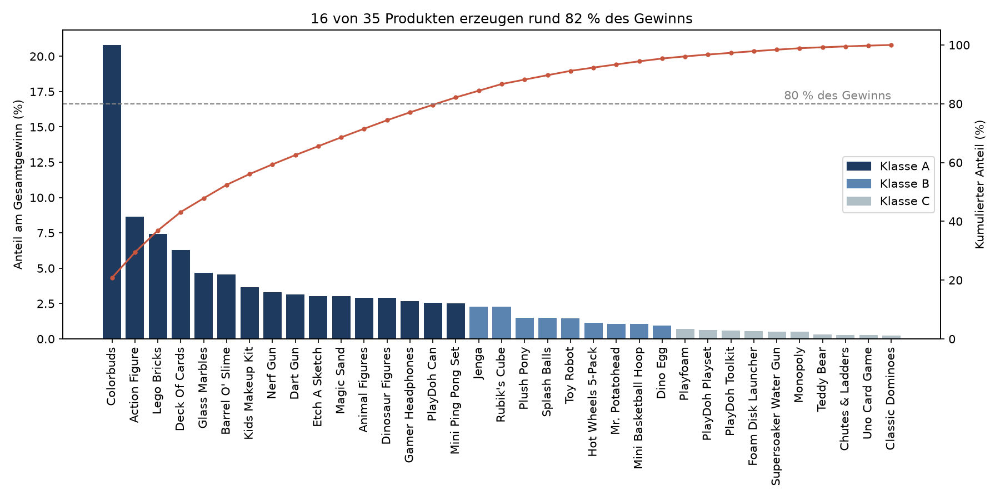
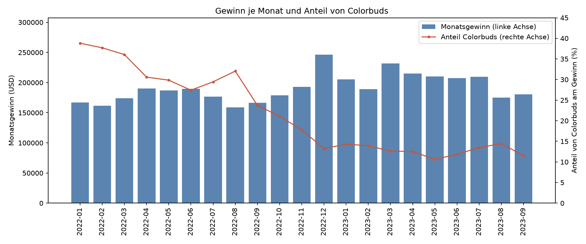
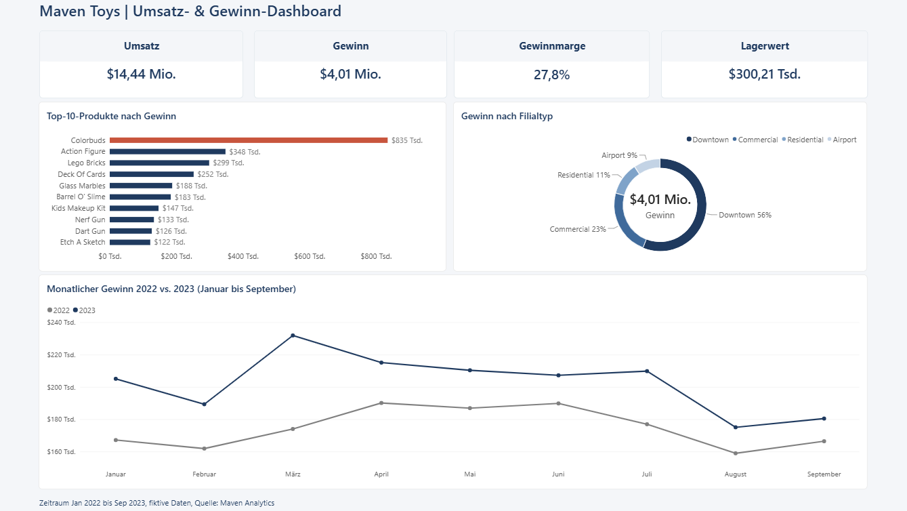

# Profitabilität einer Spielwarenkette (Maven Toys)

Analyse von Verkaufs- und Lagerdaten einer fiktiven Spielwarenkette in Mexiko: Welche Produkte und Standorte tragen am stärksten zum Gewinn bei, und wo ist Kapital im Lager gebunden?

## Projektübersicht

### Problemstellung
Eine Spielwarenkette mit 50 Filialen und 35 Produkten will wissen, womit sie ihr Geld verdient und wo Kapital gebunden ist. Die Rohdaten liegen in mehreren Tabellen vor und müssen erst bereinigt und verbunden werden.

### Ziel
Untersuchungsfrage: Welche Produkte und Standorte tragen am stärksten zum Gewinn bei, wie stabil ist dieser Beitrag, und wo ist Kapital im Lager gebunden?

Teilfragen:
1. Wie entwickeln sich Umsatz, Gewinn und Marge über die Zeit, und gibt es Saisonalität?
2. Welche Kategorien, Produkte und Filialtypen sind am profitabelsten?
3. Wie konzentriert und stabil ist der Gewinnbeitrag (ABC-Analyse, Schwankung)?
4. Wo ist Kapital im Lager gebunden?

### Methoden
- Python (pandas) für Bereinigung und Auswertung
- SQL (SQLite über SQLAlchemy) für JOINs und Abfragen
- Visualisierung mit matplotlib
- Power BI für ein Dashboard mit den wichtigsten Kennzahlen

## Daten
Datensatz "Mexico Toy Sales" von Maven Analytics: Verkäufe vom 01.01.2022 bis 30.09.2023 (829.262 Zeilen), Produkte, Filialen und Lagerbestand. Die Rohdaten sind nicht im Repository.
(Quelle: Maven Analytics, Lizenz: Public Domain)

## Setup
1. Repository klonen: `git clone https://github.com/chrishorvath8595/maven_toys_profitability.git`
2. Abhängigkeiten installieren: `uv sync`
3. Ordner für die Daten anlegen: `mkdir -p data/raw data/processed`
4. Die CSV-Dateien in `data/raw/` ablegen.

Die SQLite-Datenbank (`data/processed/maven_toys.db`) wird beim Ausführen von Notebook 02 automatisch erzeugt und muss nicht heruntergeladen werden.

## Ausführung
Notebooks in dieser Reihenfolge ausführen:
1. `notebooks/01_daten_laden.ipynb`: Daten laden und prüfen
2. `notebooks/02_daten_bereinigen.ipynb`: Bereinigung, SQL-JOINs, Gewinn und Lagerwert
3. `notebooks/03_daten_analysieren.ipynb`: Auswertung zu Teilfrage 1 bis 4
4. `notebooks/04_diagramme_empfehlungen.ipynb`: Diagramme (gespeichert in `docs/figures`) und Handlungsempfehlungen

Die zentralen Auswertungen sind zusätzlich als reine SQL-Abfragen im Ordner `sql/` abgelegt. Sie liefern dieselben Ergebnisse wie die Python-Auswertung in den Notebooks (alternativer Rechenweg) und lassen sich auf der Datenbank `data/processed/maven_toys.db` ausführen:
- `01_gewinn_je_monat.sql`: Umsatz, Gewinn und Marge je Monat
- `02_gewinn_je_kategorie.sql`: Gewinn und Marge je Kategorie (Januar bis September 2022 gegen 2023)
- `03_abc_analyse.sql`: ABC-Analyse mit Window Function
- `04_colorbuds_anteil.sql`: Anteil von Colorbuds am Monatsgewinn
- `05_lagerwert_je_kategorie.sql`: Lagerwert und Reichweite je Kategorie
- `06_produkte_ohne_bestand.sql`: Produkt-Filial-Kombinationen ohne Lagerbestand

Das Power-BI-Dashboard liegt als Datei in `powerbi/maven_toys_dashboard.pbix` (zum Öffnen wird Power BI Desktop benötigt).

## Ergebnisse

### Kennzahlen im Überblick
| Kennzahl | Wert |
|---|---|
| Umsatz (01.2022 bis 09.2023) | 14,44 Mio. USD |
| Gewinn | 4,01 Mio. USD |
| Gewinnmarge | 27,8 % |
| Lagerwert (zu Kosten) | 300.210 USD |

Im Vergleich Januar bis September 2022 gegen 2023 steigt der Umsatz um 31 % (5,32 auf 6,96 Mio. USD), der Gewinn aber nur um 16 % (1,57 auf 1,82 Mio. USD). Die Marge sinkt von 29,5 % auf 26,2 %. Preise und Kosten je Produkt sind konstant, der Rückgang entsteht durch den Produktmix: Rund ein Drittel zwischen den Kategorien, rund zwei Drittel innerhalb der Kategorien.

### Konzentration des Gewinns (ABC-Analyse)

16 von 35 Produkten (A-Produkte) erzeugen rund 82 % des Gesamtgewinns von 4.014.029 USD. Die fünf besten Produkte liefern 47,9 %. Colorbuds allein trägt 20,8 % bei und ist damit ein Klumpenrisiko.

### Stabilität des Gewinnbeitrags

Der Anteil von Colorbuds am Monatsgewinn (rote Linie) sinkt von 38,8 % im Januar 2022 auf 13,3 % im Dezember 2022 und liegt 2023 zwischen 10,6 und 14,5 %. Auch in absoluten Zahlen ist der Rückgang deutlich: Im Vergleich Januar bis September fällt der Gewinn von Colorbuds von 497.000 USD (2022) auf 233.000 USD (2023). Das ist der größte Einzelfaktor für den Margenrückgang. Das Wachstum 2023 stammt vollständig aus 11 neu eingeführten Produkten (plus rund 352.000 USD), während die 24 Bestandsprodukte rund 100.000 USD verlieren. Der Variationskoeffizient des Monatsgewinns beträgt 0,12 und enthält Trend und Saisonalität.

### Kategorien und Standorte
- Electronics hat die höchste Marge (48,1 und 40,6 %), verliert aber 39 % Gewinn. Art & Crafts ist 2023 mit 26 % des Gewinns die größte Quelle. Toys hat den größten Umsatz bei der niedrigsten Marge.
- Die Marge sinkt in allen vier Filialtypen. Airport ist pro Filiale am stärksten (nur drei Filialen), unter den Städten liegt Ciudad de Mexico pro Filiale vorn.

### Lager und Kapitalbindung
- Die Reichweite liegt je Kategorie bei 0,5 bis 0,8 Monaten. Bei einer angenommenen Zielreichweite von einem Monat liegen 25.383 USD (8,5 % des Lagerwerts) über dem Bedarf, vor allem bei Dinosaur Figures, PlayDoh Playset und Supersoaker Water Gun.
- Schnelldreher wie Dino Egg, Lego Bricks und Colorbuds haben nur 0,2 bis 0,4 Monate Reichweite.
- Nicht jede Filiale führt jedes Produkt: Im Lager sind 1.593 von 1.750 möglichen Produkt-Filial-Kombinationen geführt. 77 davon (4,8 %) haben einen Bestand von 0.

### Dashboard

Das Dashboard zeigt auf einer Seite die Kennzahlen, den Monatsverlauf, die Top-Produkte, die Filialtypen und den Lagerwert.

### Handlungsempfehlungen
1. **Rückgang von Colorbuds untersuchen:** Das Produkt trägt am meisten zum Gewinn bei, sein Anteil sinkt aber seit Anfang 2022. Ursachen (Wettbewerb, Preis, Sortiment) klären, bevor weiter auf das Produkt gesetzt wird.
2. **Neueinführungen fördern, Bestandssortiment prüfen:** Das Wachstum kommt aus neuen Produkten. Bestandsprodukte mit sinkendem Gewinn sollten auf Preis, Platzierung und Sortimentsbedarf geprüft werden.
3. **Marge neben dem Umsatz steuern:** Der Umsatz wächst deutlich stärker als der Gewinn. Der Produktmix sollte an der Marge ausgerichtet werden, nicht nur am Umsatz.
4. **Fehlbestände bei Schnelldrehern vermeiden:** Schnelldreher haben nur 0,2 bis 0,4 Monate Reichweite, und 77 Produkt-Filial-Kombinationen sind ohne Bestand. Nachbestellpunkte für diese Produkte prüfen.
5. **Überbestand bei wenigen Produkten abbauen:** Rund 25.000 USD liegen über der Zielreichweite, konzentriert auf wenige Produkte.
6. **Standortfokus prüfen:** Die Marge sinkt in allen Filialtypen. Die Ergebnisse je Filiale und Filialtyp sollten bei der Standortplanung berücksichtigt werden.

### Einschränkungen
- Wegen des größeren Sortiments 2023 ist der Vorjahresvergleich nicht ganz gleichartig.
- Die Lagerdaten sind eine Momentaufnahme ohne Datum. Reichweite und Überbestand beruhen auf einer angenommenen Zielreichweite von einem Monat und den Warenkosten von Juli bis September 2023.
- Ausreißer bei den verkauften Stückzahlen (bis 30 Stück) bleiben im Datensatz, der größte Einzelverkauf bringt 150 USD Gewinn.

## About me
Ich habe einen Bachelor in Volkswirtschaftslehre mit Vertiefung Finance und absolviere aktuell eine Weiterbildung zum Data Analyst bei StackFuel. Mein Interesse gilt Controlling, Business Intelligence und Finance. Dieses Projekt ist mein Portfolioprojekt: Es zeigt den Weg von den Rohdaten über Bereinigung, SQL und Analyse mit Python bis zum Dashboard in Power BI.

GitHub: [chrishorvath8595](https://github.com/chrishorvath8595)